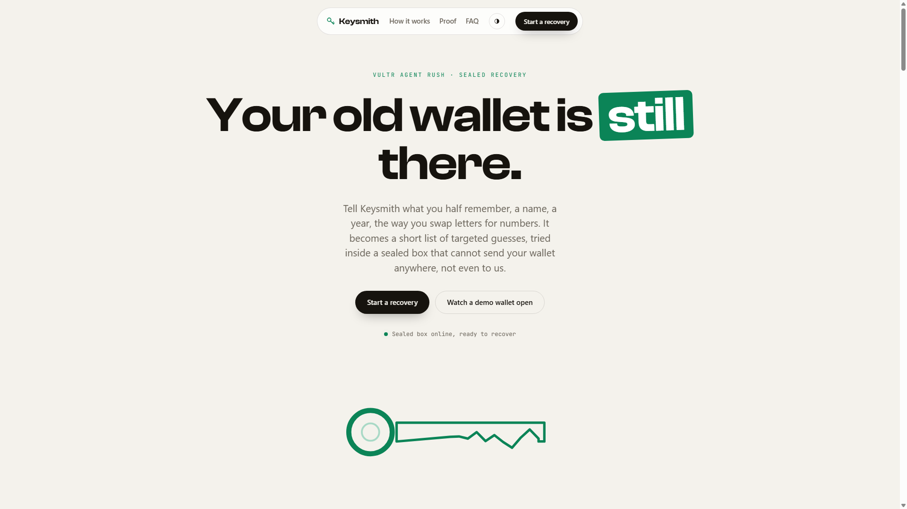
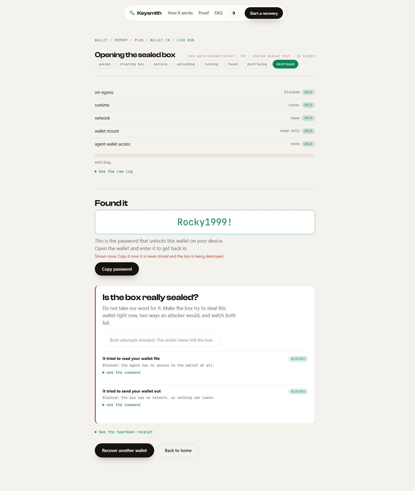
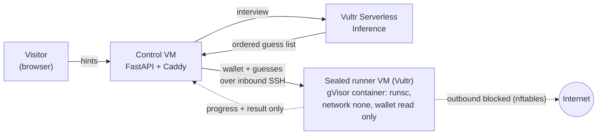
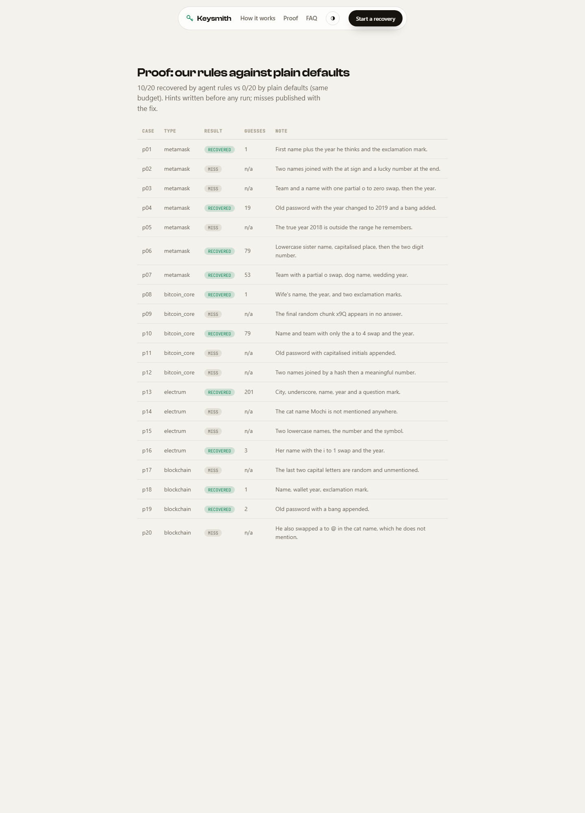

<h1 align="center">Keysmith</h1>

<p align="center"><b>You still have the wallet. You just forgot the password that opens it.</b><br/>
Keysmith turns what you half remember into a short list of targeted guesses and tries them inside a sealed Vultr box that cannot send your wallet anywhere, not even to us.</p>

<p align="center">
<a href="https://95-179-195-57.sslip.io"></a>
<a href="https://youtu.be/l7h8wTJi5nI"></a>
<a href="https://www.vultr.com"></a>
<a href="LICENSE"></a>

</p>

<p align="center"></p>

Lost crypto does not have a cracking problem. It has a trust problem: the only people who
can help you are the ones you would least want holding your wallet file. Recovery firms take
around 20 percent of the coins and need your file in their hands. The FBI keeps warning about
the scams. Keysmith removes the trust. Every recovery runs in a sealed box with no network,
your wallet mounted read only, the reasoning agent locked away from the file, and the box
destroyed afterwards with a receipt that proves nothing left.

Built for the Vultr Agent Rush hackathon, Challenge 1, Blast Radius Zero.

> **Password, not seed phrase.** A wallet like MetaMask or Bitcoin Core has two secrets: the
> seed phrase (the master backup, unrecoverable if truly lost) and the password that encrypts
> the wallet file on your device. Keysmith recovers the second one, for when you still have the
> wallet but forgot the password. That is exactly the case behind the viral 5 BTC recovery.

## Judge fast path (one minute, no keys, no setup)

1. Open **https://95-179-195-57.sslip.io**
2. Click **Watch a demo wallet open**. A real encrypted test wallet (no funds) loads with its owner's fuzzy memories prefilled.
3. Click **Build the plan**. A model on Vultr writes the exact, ordered guess list; you see it before anything runs.
4. Click **Accept and open the box**. A sealed box opens on Vultr, the containment checks go green, and the password appears.
5. Click **Make the box try to steal the wallet**. Watch both attempts, reading the wallet and sending it out, get **blocked**, live.
6. See the teardown receipt: wallet bytes egressed, **0**.

Prefer your own wallet? Click **Start a recovery** and upload your wallet file.

<p align="center"></p>

## Architecture



One **control VM** serves the app and API. A **warm sealed runner VM** stays booted with
Docker, gVisor and the btcrecover image baked in, so each recovery runs as a fresh gVisor
container on it and starts in seconds instead of waiting on a VM boot. The host egress lock and
per container `--network=none` make the box unable to talk out; the container and the job files
are wiped after each run. A per job VM mode (a fresh Vultr VM from a snapshot, created and
destroyed for every job) ships in the same code for teams that want one throwaway machine per
recovery. Full contract in [`docs/ARCHITECTURE.md`](docs/ARCHITECTURE.md).

## How the sealed box works

```
your wallet ──inbound SSH──> sealed box on Vultr
                              nftables: output + forward + input drop (SSH only)
                              cracker container: runsc, --network=none, wallet :ro
                              agent container:   runsc, --network=none, NO wallet
                              <── progress only ──  (the wallet can never leave)
                              then: container removed, job files wiped
```

The box can open no outbound connection. The only channel is the control VM's inbound SSH, and
only progress numbers and the final result travel back. A poisoned hint that tells the agent to
read the wallet and phone home fails twice: the agent has no wallet mount, and the network is
off. You can trigger both failures yourself with the break in test on any run. Proven on real
infrastructure in [`docs/spikes/sealed-vm.md`](docs/spikes/sealed-vm.md).

## Proof: memory beats brute force

A blind answer key of 20 test wallets, with the owner's hints written **before any run**, lives
in [`data/proof/cases.json`](data/proof/cases.json). Each case runs our rules against plain
btcrecover defaults on the same budget. We publish the misses, not only the wins.

| | Recovered |
|---|---|
| Keysmith rules | **10 of 20** |
| Plain defaults | **0 of 20** |
| Honest misses correctly missed | **5 of 5** (no false positives) |

Live at **[/proof](https://95-179-195-57.sslip.io/#/proof)**.

<p align="center"></p>

## Vultr services used

| Service | Where |
|---|---|
| **Serverless Inference** (`api.vultrinference.com`) | Every model call. The interview turns memories into a hint profile. One client: [`src/keysmith/llm.py`](src/keysmith/llm.py), model `deepseek-v4.1-flash-1017`. |
| **Cloud Compute** | The control VM that serves the app, and the sealed runner VM that runs recoveries. |
| **Vultr API** (`api.vultr.com/v2`) | Builds the hardened runner image, and (in per job mode) creates and destroys a fresh VM per recovery. |

## What is real, and what is not

| Part | Status |
|---|---|
| Recovery logic (hint schema, rule compiler, estimator, receipt) | Real. Pure, deterministic, 71 tests. |
| Interview writes the guess profile | Real. Vultr Serverless Inference. |
| Sealed box runs the guesses | Real. gVisor container, no network, wallet read only, on a Vultr VM. |
| Containment | Real. Observed live on the run page and in the break in test, not asserted. |
| Proof: our rules vs plain defaults | Real. 20 blind test wallets, misses published. |
| Found password / wallet bytes | Never stored. Shown once from the live stream, then gone. |
| Payments | Not built for the hackathon. Pricing is stated, not charged. |

## Reproduce it

```bash
pip install -r requirements.txt
python -m keysmith            # serves on http://127.0.0.1:8000
python -m pytest -q           # 71 tests
```

With no Vultr keys the app serves a scripted demo and the runner ships as a `NullRunner`, so it
never fakes a real recovery. To run real sealed recoveries on Vultr, set the env vars in
[`docs/RUNNING.md`](docs/RUNNING.md).

## Scope and limits

- Works when your password came from things you can still half remember. It will not crack a
  strong random password, and it says so before you spend time.
- It recovers the password that decrypts a wallet file you still have. It does not recover a
  lost seed phrase; a truly lost seed is unrecoverable by anyone.
- It cannot verify wallet ownership. The policy is stated plainly, it stores nothing, and it
  adds no capability the underlying open tool does not already have. Only run it on wallets you own.

## The number that matters

Recovery firms take around 20 percent of the coins and need your wallet file. Keysmith is a flat
fee per job and never holds your file. On a 5 BTC wallet, that is the difference between keeping
your coins and handing over about one of them.
